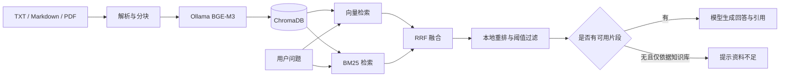

# miniAgent

基于 Python 的个人知识库助手，具备基础 RAG、流式对话和部分 Agent 工具能力。上传资料后提问，可在回答中查看来源引用并展开核对原文。

项目使用 Gradio 提供网页界面，通过 Ollama 运行 BGE-M3，结合 ChromaDB、BM25 和本地 ONNX 重排检索资料，再调用 OpenAI 兼容模型服务生成回答。

## 功能

- **资料导入**：支持 TXT、Markdown 和带文字层的 PDF，保留标题、行范围或页序号等来源信息。
- **混合检索**：BGE-M3 语义检索与 BM25 关键词检索，通过 RRF 融合排名；支持单独使用向量或 BM25。
- **本地重排**：使用 BGE Reranker Base 的 ONNX INT8 版本，在 CPU 上评分并按阈值筛选。
- **引用溯源**：回答使用 `[资料1]` 等编号，提供原文展开区域和候选分数表。
- **文档管理**：重复导入跳过、同名更新、重新分块、确认删除及回收站备份。
- **对话记录**：SQLite 保存聊天历史，较长上下文通过摘要压缩。
- **Agent 工具**：普通聊天模式支持时间查询、Tavily 联网搜索和项目目录内的文件读写。

默认启用“优先检索知识库”和“仅依据知识库回答”。检索在每次提问前由程序执行；仅依据知识库模式禁用工具，无片段通过筛选时直接提示资料不足。

文档解析、向量生成、检索和重排在本机完成；问题、参与回答的历史与检索片段会发送到配置的模型服务。是否离线运行取决于生成模型服务的部署方式。

## 工作流程



## 快速开始

推荐使用 **64 位 Python 3.11**。以下以 Windows PowerShell 和 `D:\miniAgent2.0` 为例；先将仓库克隆或下载到该目录，也可以使用自己的项目路径。

### 1. 安装依赖

先检查现有 Python 环境；已有可用的项目虚拟环境可以复用。

```powershell
Set-Location D:\miniAgent2.0
py -3.11 --version
py -3.11 -m venv .venv
.\.venv\Scripts\python.exe -m pip install -r requirements.txt
```

直接调用虚拟环境中的 Python，无需执行激活脚本。Linux / macOS 使用 `.venv/bin/python` 替换解释器路径，并相应调整命令写法。

### 2. 准备本地模型

安装并启动 [Ollama](https://ollama.com/)，检查已有模型后准备 BGE-M3：

```powershell
ollama list
ollama pull bge-m3
.\.venv\Scripts\python.exe src\setup_reranker.py
```

如果 Ollama 尚未运行，可在另一终端执行 `ollama serve`。

重排模型来自 [Xenova/bge-reranker-base](https://huggingface.co/Xenova/bge-reranker-base)，下载脚本固定版本并校验 SHA256。模型与 tokenizer 合计约 296 MB，默认保存在 `models/bge-reranker-base/`，无需安装 PyTorch 或 CUDA。

聊天请求不会自动下载重排模型；模型缺失或运行失败会报错，可在界面手动关闭重排。Ollama 模型由 Ollama 单独管理，不会复制到项目 `models/`。

### 3. 配置服务

首次使用时复制配置模板，已有 `.env` 则直接编辑：

```powershell
if (-not (Test-Path .env)) { Copy-Item .env.example .env }
notepad .env
```

至少填写模型服务地址、密钥及实际可用的模型名称：

```dotenv
OPENAI_API_KEY=your_model_api_key
OPENAI_BASE_URL=https://your-openai-compatible-provider.example/v1
CHAT_MODEL=your_chat_model
SUMMARY_MODEL=your_chat_model
```

服务需支持 OpenAI 兼容的 Chat Completions 和流式输出；使用 Agent 工具时还需支持工具调用。模板中的 `deepseek-flash` 是默认标识，请按服务商提供的模型名称修改。`TAVILY_API_KEY` 为可选项，未配置不影响本地知识库检索。

### 4. 自检并启动

```powershell
.\.venv\Scripts\python.exe src\startup_check.py
.\.venv\Scripts\python.exe src\knowledge_assistant.py
```

浏览器访问 <http://127.0.0.1:7860>。自检会检查 Ollama、重排文件、生成模型配置和本地数据库；不会发送生成请求，因此配置检查通过不代表服务端模型一定可用。

## 使用方法

1. 在“知识库管理”中选择资料，点击“导入 / 更新资料”，等待导入成功。
2. 输入问题，回答中的 `[资料N]` 对应本轮选中的片段，展开来源查看原文。
3. 在“检索设置与候选分数”中切换检索方式、调整候选数量、重排阈值及最终片段数。
4. 普通聊天可关闭知识库检索；关闭“仅依据知识库回答”后可使用 Agent 工具。
5. 删除资料时选择文件，核对清单并勾选确认，再点击“删除所选文档”。

候选表用于诊断，不表示所有候选都参与了回答。重排分数表示相关性，不是答案正确率；即使有片段通过筛选，仍需核对原文是否支持结论。程序会标记不存在的引用编号，但不会自动验证全部结论。

### 检索与分块参数

| 参数 | 默认值 | 说明 |
| :--- | :--- | :--- |
| 每块字符数 / 重叠字符数 | 1200 / 180 | 重叠须小于块大小的一半 |
| 每路召回候选数 | 20 | 分别控制向量和 BM25 召回 |
| 最多重排候选数 | 20 | 对融合后的前若干候选评分 |
| 重排最低分数 | 0.20 | 关闭重排时不生效 |
| 最多送入回答的片段数 | 4 | 参考原文总长不超过 12000 字符 |

BM25 索引在首次关键词检索时从 Chroma 文本构建，缓存在进程内；文档更新或删除后失效重建，无需为启用 BM25 重新生成向量。混合与向量检索依赖 Ollama，连接失败不会自动切换检索方式。

重排使用最多 512 token 的窗口处理长片段，重排问题超过 128 token 时使用前 128 token；生成模型仍接收完整问题。默认阈值来自小规模合成集校准，实际资料应重新评估。

也可以从命令行导入指定文件：

```powershell
.\.venv\Scripts\python.exe src\ingest.py "D:\documents\资料.md"
```

### 文档更新与恢复

同名文件视为同一文档，不同资料请使用不同文件名。相同内容和分块设置重复导入会跳过；内容或分块设置变化后重新生成向量，成功后清理旧块，旧原文保存在 `knowledge/.versions/`。

删除会将原文与索引恢复快照保存到 `data/trash/<批次>/`，再清理当前索引。误删后可重新上传回收站中的原文来重建索引，目前没有一键恢复功能。旧版本和已有聊天记录会保留；“清空聊天”只清空当前会话，不删除知识库。

普通删除异常会尝试回滚；突然断电或强制结束进程可能需要检查回收批次的 `manifest.json` 和恢复快照。请通过界面删除资料，手动删除原文件不会同步清理向量记录。

## 配置项

配置由 `src/config.py` 从项目根目录 `.env` 读取，已设置的进程环境变量优先。相对路径以项目根目录为基准。

| 变量 | 默认值 | 说明 |
| :--- | :--- | :--- |
| `OPENAI_API_KEY` | 空 | 生成模型服务密钥 |
| `OPENAI_BASE_URL` | 空 | OpenAI 兼容服务地址，建议显式配置 |
| `CHAT_MODEL` | `deepseek-flash` | 回答模型，按服务商修改 |
| `SUMMARY_MODEL` | 跟随 `CHAT_MODEL` | 历史摘要模型 |
| `OLLAMA_BASE_URL` | `http://127.0.0.1:11434` | Ollama 服务地址 |
| `RAG_EMBED_MODEL` | `bge-m3:latest` | 文档与问题使用相同的 embedding 模型 |
| `RAG_RERANK_MODEL_DIR` | `models/bge-reranker-base` | ONNX 重排模型目录 |
| `TAVILY_API_KEY` | 空 | 可选，联网搜索密钥 |
| `APP_HOST` / `APP_PORT` | `127.0.0.1` / `7860` | 网页监听地址与端口 |
| `LOG_LEVEL` | `INFO` | 日志级别 |
| `STRICT_KNOWLEDGE_DEFAULT` | `true` | 默认仅依据知识库回答 |
| `MEMORY_DB_PATH` | `data/memory.sqlite3` | SQLite 聊天数据库路径 |

上下文超过 30 条消息时压缩较早内容，保留最近 8 条原文；SQLite 中仍保存完整历史。首次启动可迁移旧版 `sessions/knowledge_history.json`，原文件保留为备份。当前没有自动提取长期用户事实或偏好的独立记忆系统。

## 项目结构

```text
miniAgent2.0/
├── src/
│   ├── knowledge_assistant.py   # 网页、流式聊天与文档管理
│   ├── ingest.py                # 文档解析、分块与增量导入
│   ├── rag.py                   # 混合检索、引用与回收站管理
│   ├── rerank.py                # ONNX CPU 重排
│   ├── setup_reranker.py        # 固定版本模型下载与校验
│   ├── memory_store.py          # SQLite 聊天历史
│   ├── config.py                # 配置与日志
│   ├── startup_check.py         # 启动自检
│   └── local.py                 # 独立的本地模型调用示例
├── tests/                       # 单元测试、集成验证与检索评估
│   └── fixtures/                # 合成文档与标注问题
├── .github/workflows/ci.yml     # GitHub Actions
├── .env.example                 # 配置模板
├── .gitignore
├── requirements.txt             # Python 直接依赖
└── README.md
```

运行时目录包括 `knowledge/`（原文与旧版本）、`data/`（向量库、聊天数据库、日志与回收站）、`models/`（重排模型）、`sessions/`（旧历史）和 `.cache/`（上传、分词缓存与测试产物）。这些目录及 `.env`、虚拟环境均已加入 `.gitignore`，发布到 GitHub 时不应提交个人资料和密钥。

## 测试与评估

离线单元测试与 GitHub Actions 使用相同方式，不调用 Ollama 或生成模型服务；本地存在重排模型时仍会运行真实 ONNX 测试：

```powershell
$env:MINIAGENT_OFFLINE_TESTS = "1"
.\.venv\Scripts\python.exe -B -m unittest discover -s tests -p "test_*.py" -v
Remove-Item Env:MINIAGENT_OFFLINE_TESTS
```

准备好 Ollama、BGE-M3 和本地重排模型后，可以运行完整测试与评估：

```powershell
.\.venv\Scripts\python.exe -B -m unittest discover -s tests -v
.\.venv\Scripts\python.exe -B tests\evaluate_retrieval.py
.\.venv\Scripts\python.exe -B tests\evaluate_rerank.py
.\.venv\Scripts\python.exe -B tests\smoke_document_management.py
```

完整回答流程验证会调用配置的生成模型服务：

```powershell
.\.venv\Scripts\python.exe -B tests\smoke_assistant.py
```

测试使用项目 `.cache/` 下的隔离资料与向量库。网页验证使用本机 7862（文档管理）和 7861（回答流程）端口。

评估使用 6 份合成文档、10 个校准问题和 8 个保留验证问题；报告保存在 `.cache/` 下，用于比较检索方式和校准阈值，不能等同于真实资料的回答准确率。

## 当前限制

- 单文件不超过 30 MiB；扫描 PDF 需先 OCR，暂不支持 Word、Excel 或图片直接入库。
- PDF 引用为文件页序号，可能与印刷页码不同。
- 面向个人、单机、单进程使用，尚无登录、用户隔离或多进程写入支持。
- 文件工具可以读写项目目录内的文件；使用工具模式前应确认项目中存放的内容适合交给模型处理。
- 不要直接为已有向量库切换 embedding 模型；更换模型需使用独立库并重新索引。
- 重排阈值无法保证识别所有无答案问题，引用与缺失事实仍需人工核对。
