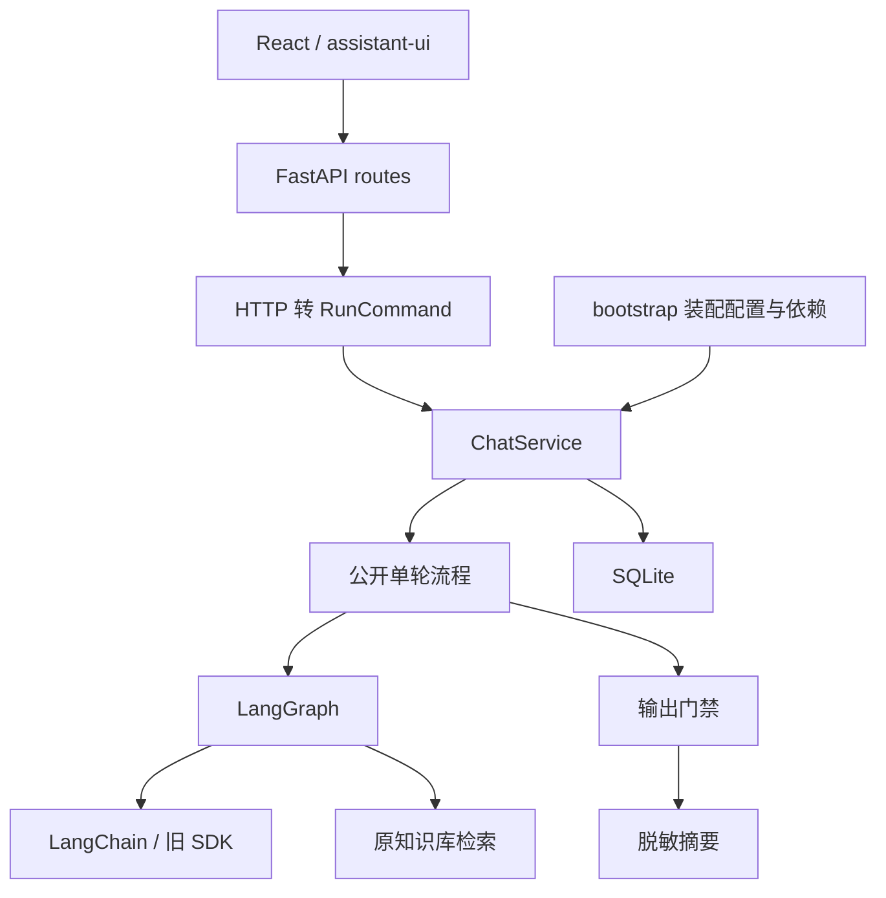

# 项目结构与依赖边界

正式 Python 包位于 `src/miniagent/`，前端位于 `frontend/`。根目录 `.env`、`knowledge/`、`data/` 和 `models/` 保持原位置，本次没有迁移数据。

## 当前目录

```text
src/miniagent/
├── bootstrap.py              # 入口装配模型、策略及服务
├── runtime.py                # 请求级配置与策略，异步/线程隔离
├── config.py                 # 配置读取；导入不初始化日志
├── contracts.py              # ChatRequest、RunCommand 和事件
├── api/
│   ├── app.py                # 生命周期、中间件、路由挂载
│   ├── mapping.py            # HTTP 请求转内部命令
│   ├── streaming.py          # SSE 编码
│   ├── schemas.py            # 参数校验
│   └── routes/               # chat、threads、documents
├── application/
│   ├── chat_service.py       # 运行、取消、会话持久化
│   ├── chat.py               # 公开单轮执行接口、生产安全包装
│   ├── context.py            # 历史内容归一化
│   ├── documents.py          # 文档管理用例
│   └── uploads.py            # 受限上传暂存与清理
├── knowledge/
│   ├── rag.py                # 混合检索与重排调度，兼容原接口
│   ├── store.py              # Chroma 延迟装配和文档事务
│   ├── recycling.py          # 原快照、删除与回滚
│   ├── sources.py            # 资料名规则
│   ├── ingest.py             # 增量入库和原文版本
│   ├── parsing.py            # 文本/PDF 解析和分块
│   ├── rerank.py             # ONNX 原推理
│   └── citations.py          # 引用数据
├── security/
│   ├── policy.py             # 权限策略、配置加载、兼容接口
│   ├── injection.py          # 规则检测
│   ├── admission.py          # 入库检查
│   ├── context.py            # 片段审查
│   └── output.py             # 完整审核后发布
├── observability/
│   ├── logging.py            # 启动时日志装配
│   ├── decisions.py          # 安全决策的日志/审计/统计出口
│   ├── audit.py              # 独立本地审计
│   ├── tracing.py            # 脱敏摘要
│   └── langsmith.py          # 显式摘要导出
├── experiments/
│   ├── rules.py              # 规则基线
│   ├── matrix.py             # 对照、消融、评分
│   └── compare.py            # 比较与统计导出
├── adapters/                 # LangChain、旧 SDK
├── workflows/                # LangGraph
├── tools/                    # 工具与知识库会话
├── memory/                   # SQLite
├── prompts/
├── cli/
└── ui/                       # 迁移期间保留 Gradio
```

前端 `App.tsx` 负责布局，`components/SettingsPanel.tsx` 和 `components/SourcesPanel.tsx` 分别负责设置和来源展示；`Chat.tsx` 保留 assistant-ui 适配，`useChat.ts` 保留共同的会话/运行生命周期。

根目录 `evaluations/` 保存数据集、原基线及薄入口；实验实现只保存在包内。旧命令继续有效，CLI 不再用 runpy 执行测试实现。

## 调用方向



- ChatService 不导入 bootstrap，也不读取 Pydantic options；依赖工厂由入口注入。
- RuntimeEnvironment 显式绑定配置和策略。安全检查、工具、输出密钥检查、追踪与审计采用相同请求环境；异步任务与检索线程继承环境，退出即还原。
- FastAPI 默认知识库明确接收 embedding 模型、Ollama 地址及策略；显式传入实例时保留该实例，调用者负责其存储配置。
- 生产 stream_chat 固定启用工作流和输出审核；实验使用公开 execute_chat/stream_pipeline 组装，防护选项没有进入 HTTP schema。
- LangChain 模型构造支持 model_factory，实验无需替换模块全局函数。正式矩阵不再依赖 unittest.mock 或私有执行函数。
- 原历史固定输出脚本 evaluations/baseline.py 仍可使用 mock；它是兼容性测试，不是正式矩阵核心。
- KnowledgeBase 的存储与回收通过内部 mixin 共享原 collection 和锁；document_transaction、snapshot 提供公开边界，不复制索引或事务。
- 保留必要兼容导出：ingest 的解析函数、rag 的知识库接口、policy 的安全接口及 chat 的文本归一化函数。

不为每个函数增加 Repository/Factory 转发层。ONNX、SQLite、LangChain/LangGraph 循环和前端 useChat 生命周期保留，避免把共同状态拆成难以协调的对象。

## 运行与兼容

`python -m miniagent` 仍访问 8000；旧界面 `miniagent-gradio` 使用 7860。共用知识库时不要同时执行文档变更。HTTP URL、collection、分块 profile、回收快照和 SQLite 表结构不变。

```powershell
conda activate miniAgent2.0
python -m miniagent
python evaluations/security.py --output-dir D:/miniAgent2.0-experiments/phase6
python -m miniagent.cli.evaluate run --output-dir D:/miniAgent2.0-experiments/rules
```

本次没有安装新依赖，无需重新注册可编辑包；前端已构建。验收资料、结果与路径见 [重构验收](refactor.md)。历史 phase1–phase6 文档保留，旧目录示意以本页为准。
