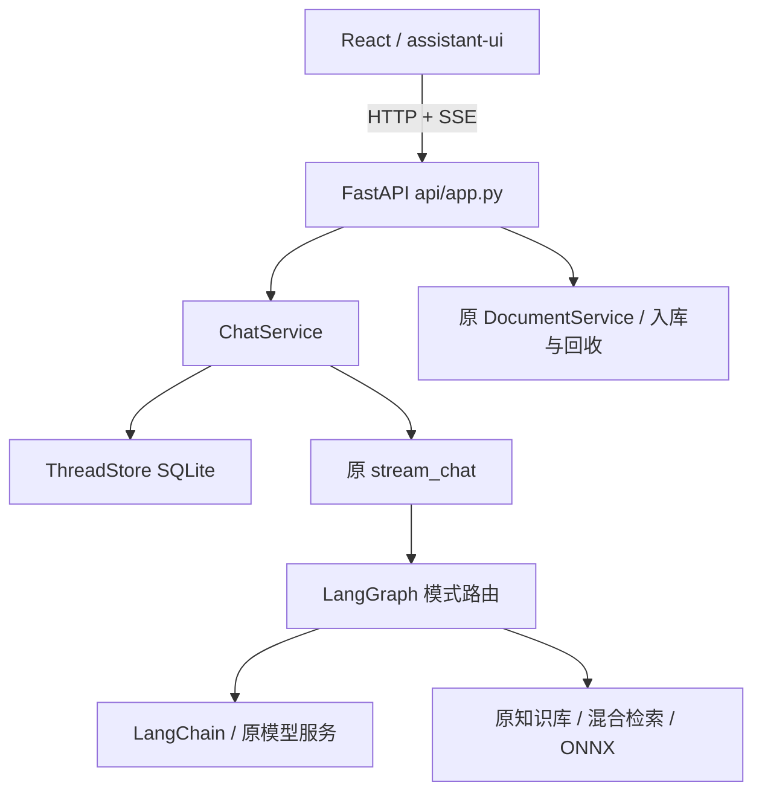

# assistant-ui 前端与统一聊天服务

本次把页面和 Python 聊天逻辑分开，保留原有模型服务、LangChain / LangGraph、混合检索、ONNX 重排和 Gradio。当前是个人本机应用，不提供公网登录、用户权限隔离或多进程运行。

## 如何启动

源码保留在当前工作区，不复制或迁移知识库。已有 Python 环境使用 `D:\.conda\envs\miniAgent2.0\python.exe`；已有 Node.js 直接复用，不安装全局 npm 包。

```powershell
# 在项目根目录运行；明确指定已有虚拟环境，避免误装到全局。
& D:\.conda\envs\miniAgent2.0\python.exe -m pip install -r requirements.txt
& D:\.conda\envs\miniAgent2.0\python.exe -m pip install --no-deps --no-build-isolation -e .
Set-Location frontend
npm ci --cache D:\npm-cache
npm run build
Set-Location ..
& D:\.conda\envs\miniAgent2.0\python.exe -m miniagent
```

访问 <http://127.0.0.1:8000>。构建只在安装后或修改前端后执行，平时只需最后一条 Python 命令。前端依赖在 `frontend/node_modules/`，构建在 `frontend/dist/`，均不提交 Git；`package-lock.json` 提交以固定依赖。

开发时先启动 Python，再在另一终端执行 `cd frontend`、`npm run dev`，访问 <http://127.0.0.1:5173>。Vite 将 `/api` 代理到 8000，无需给模型服务暴露浏览器密钥。

Gradio 保留：激活同一环境后执行 `miniagent-gradio`，端口 7860。两个界面共享原向量库，操作锁只覆盖新 API，不能同时通过两个界面修改资料。不要启动多个 API worker。

## 调用关系



可以把 assistant-ui 理解为聊天窗口组件：负责输入、消息、Markdown 和停止按钮。它通过 `useExternalStoreRuntime` 接收我们维护的消息状态，不要求把 Python 改成 JavaScript，也不依赖 assistant-ui 云服务。

FastAPI 是窗口通往 Python 的入口；ChatService 是统一的聊天柜台：读取服务端历史、创建运行、驱动原流程、发事件、保存结果。前端没有复制 Agent 循环，也不能传入伪造的完整历史替换服务器记录。

| 文件 | 输入 | 输出及职责 |
| --- | --- | --- |
| `frontend/src/App.tsx` | 会话及页面操作 | 会话列表、设置和来源面板 |
| `frontend/src/Chat.tsx` | 结构化消息、发送/取消回调 | assistant-ui 聊天界面 |
| `frontend/src/useChat.ts` | 用户问题、设置 | HTTP 请求、事件合并、历史恢复 |
| `frontend/src/api.ts` | HTTP 响应字节流 | 解析 SSE，支持分包和 UTF-8 |
| `frontend/src/KnowledgePanel.tsx` | 文件、分块参数、删除确认 | 原文管理请求与列表 |
| `src/miniagent/api/schemas.py` | JSON 参数 | 校验后的运行和删除请求 |
| `src/miniagent/api/app.py` | HTTP / 上传文件 | API、SSE、构建后的静态页面 |
| `src/miniagent/application/chat_service.py` | thread ID、问题、选项 | 结构化事件、终态、持久化 |
| `src/miniagent/memory/thread_store.py` | 会话、消息、运行 | 独立 SQLite 存储、旧历史只读适配 |
| `src/miniagent/application/chat.py` | 原 ChatRequest | 原 ChatEvent，增加工具活动数据 |

## 接口与事件

| 方法与路径 | 用途 |
| --- | --- |
| `GET /api/health` | 后端、模型标识、能力声明；不测试模型连通性 |
| `GET / POST /api/threads` | 会话列表 / 新建 |
| `GET /api/threads/{id}/messages` | 读取持久化消息及来源 |
| `DELETE /api/threads/{id}` | 删除该会话，不删资料 |
| `POST /api/threads/{id}/runs` | 发起一轮并接收 SSE |
| `GET /api/runs/{id}` | 运行状态 |
| `POST /api/runs/{id}/cancel` | 停止生成并保存已有部分 |
| `GET /api/legacy/messages` | 只读展示旧版聊天正文 |
| `GET /api/documents` | 文档清单与索引状态 |
| `POST /api/documents/upload` | multipart：files、chunk_chars、overlap_chars |
| `POST /api/documents/delete` | sources 清单与 confirmed=true |

聊天请求示例，`run_id` 为客户端每轮生成的新 UUID：

```json
{"run_id":"5bdc3e02-7e9f-45f0-9f07-86c14b67a245","message":"冷却液多久更换？","options":{"mode":"forced","only_knowledge":true,"retrieval_mode":"hybrid","use_rerank":true}}
```

SSE 包含 `type`、`seq`、`run_id`、`thread_id`、`message_id`、`data`。事件包括开始、文本增量、全文替换、状态、检索完成、工具开始/结束和运行终态。引用后处理有时修改已生成文本，因此必须支持 `message.replace`，不能只拼接增量。

终态为 completed、refusal、failed、cancelled；重启时将遗留 running 标记 interrupted。取消保存已收到的部分；强制结束进程不保证保存未完成文本。失败和取消的整轮不进入后续模型上下文，但可在页面查看。当前不支持断流续传，重新连接后读取服务器保存结果。

上传支持 TXT、MD、带文字层 PDF，单文件 30 MiB、一次最多 8 份/64 MiB，拒绝路径穿越和同批同名文件。删除复用原回收站机制。聊天和文档变更共享单进程锁，冲突返回 409。来源字段只暴露原文和诊断数据，不返回 embedding。

## 数据与后续扩展

新界面默认使用 `data/web_chat.sqlite3`，不迁移、不覆盖旧 `data/memory.sqlite3`。旧消息只读提取正文，旧 HTML 来源块不会当成新界面组件执行。原 `knowledge/`、Chroma collection、模型服务配置不变。

目前展示引用原文片段和候选分数，不是完整 PDF 浏览器。工具事件和运行 ID 已预留扩展，但人工审批/恢复执行尚未实现，健康接口明确返回 approval=false。LangSmith 仍由后端负责；本次没有自动开启追踪或上传个人资料。后续在工作流中接入追踪、权限节点与审批持久化，前端消费对应事件即可。

同源检查和参数校验只解决这次 HTTP 接入的基本边界，不等于完成文档投毒检测、文档访问控制和输出审查。完整安全实验平台仍按后续安全阶段实现。

## 本次验收

未读取用户正式资料。固定回答用于页面交互验收，真实模型用于后端联调，两类证据分开记录。

| 材料 | 检查 | 结果 |
| --- | --- | --- |
| 原六份合成资料、固定时间、注入样例；新增“冷却液九天更换”与合成异常 | Python 回归、API 流、会话隔离、重复运行、参数/来源校验、取消、并发拦截、重启恢复、旧库只读 | 65 项全部通过，其中新增 API/运行服务 6 项 |
| 浏览器合成维护手册 + 固定流式回答 | 发送、Markdown、工具状态、来源、刷新历史、独立会话、停止后保存 | 2 个 Edge 端到端场景通过，含上传/删除和 390px 布局 |
| 人工构造的 SSE 字节流 | UTF-8 分包、事件边界与错误响应 | 2 项前端单测通过 |
| 星舟维护.md：冷却液每九天更换、更换前关闭设备 | 原 DeepSeek + Ollama BGE-M3 + ONNX，经新 API 强制检索 | 回答九天，来源正确并带引用 |
| 数据备份.md：每天凌晨三点备份，保留十四天 | Agent 自主调用知识库工具 | 回答十四天，存在工具完成事件与来源 |
| “月球背面陨石坑如何命名？”；上述资料未提供答案 | 仅知识库模式 | 直接拒答 |

本次真实模型三轮合计持久化六条消息，全部通过；该小样例不能作为真实资料准确率或安全防御有效率。

报告在 `D:\miniAgent2.0-experiments\web\live-api-hp_0rakq\report.json`，浏览器隔离库也在该 D 盘实验目录下。单元测试沿用项目 `.cache/` 隔离库，不写正式资料或旧聊天。截图在忽略目录 `frontend/test-results/`。
最终 Python 回归日志在 `D:\miniAgent2.0-experiments\web\final-tests.txt`。`pip check`、前端 TypeScript/Vite 构建、前端单测与两项浏览器场景均通过。构建目前提示 JS 单包约 736 kB（gzip 约 222 kB），属于性能优化项，不影响本次运行。

复现命令：

```powershell
& D:\.conda\envs\miniAgent2.0\python.exe -B -m unittest discover -s tests -p "test_*.py" -v
# 会调用现有模型服务，仅使用脚本合成资料。
& D:\.conda\envs\miniAgent2.0\python.exe -B tests/smoke_api_live.py
# 浏览器测试：一个终端启动隔离服务，另一个终端运行 npm 测试。
& D:\.conda\envs\miniAgent2.0\python.exe -B tests/serve_web_fixture.py
```

```powershell
Set-Location frontend
npm test
npm run build
npm run test:e2e
```

浏览器验收复用已安装的 Microsoft Edge，不下载浏览器。GitHub Actions 执行 Python 离线回归、前端单测与构建；端到端测试需要单独启动上述隔离服务，尚未加入 CI。
