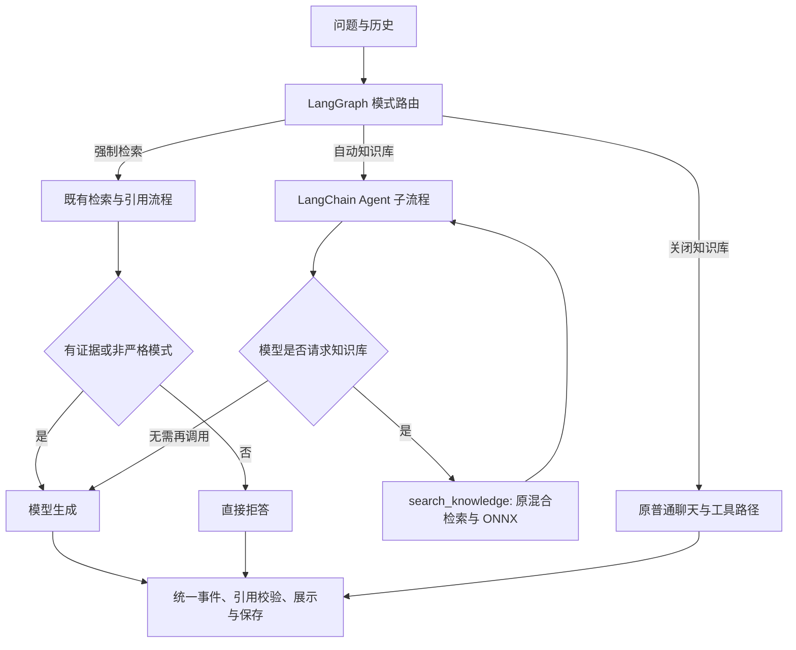

# 第三阶段：LangGraph 工作流与自主知识库工具

## 实现范围

本阶段复用已安装的 LangChain 和 LangGraph，不增加依赖、不切换模型服务、不重建正式向量库。
新增工作流只处理单轮状态，聊天记录继续由既有 SQLite 保存，不增加检查点数据库。
完整权限、文档投毒检测和工具审批属于后续阶段，本次不宣称已经实现。



LangGraph 的 `route` 节点选择 `forced` 或 `automatic` 节点。后者调用 LangChain 的 `create_agent` 子流程，模型与工具循环只有框架提供的一套。
强制节点复用原有服务：先检索、筛选、组装资料，再生成或拒答，不另外复制检索算法。

## 使用方法

激活用户指定的 `miniAgent2.0` 环境，运行 `python -m miniagent`。

- 默认“强制知识库检索”：与原行为一致，“仅依据知识库回答”开启时无证据不调用模型。
- 切换“Agent 自动决定是否检索”：启用知识库时模型只获得 `search_knowledge`，问候无需查询，个人手册问题可自主查询。
- 自动模式中的“仅依据知识库回答”开关不生效；自动模式可能直接回答，不能把它视为程序保证的强制有据问答。
- 关闭知识库：回到原普通聊天和现有工具路径。
- 自动模式仅支持 `CHAT_BACKEND=langchain`；旧 SDK 选择自动模式时明确报错，不悄悄换模型或后端。

自动知识库路径暂不提供文件、联网工具，避免在权限与审批尚未完善前扩大可执行操作。
严格模式的程序约束继续保留；自动模式中“遇到个人资料先检索”的选择仍受模型判断影响，不保证每个问题都会正确路由。

## 文件及数据流

| 文件 | 输入 | 输出与职责 |
| --- | --- | --- |
| `workflows/state.py` | ChatRequest | 模式、结束状态，不携带数据库连接 |
| `workflows/chat_graph.py` | 请求、依赖、既有服务函数 | ChatEvent 流；组织分支，不自行执行模型工具循环 |
| `tools/retrieval.py` | 模型 query、服务端请求参数 | 工具参考文本 + 仅应用层使用的原文/诊断 artifact |
| `adapters/llm.py` | 消息与本轮工具集合 | 文本、工具状态及检索 artifact 事件 |
| `application/chat.py` | 图事件及原文 | 更新候选与引用，校验引用编号并输出最终事件 |
| `ui/handlers.py`、`ui/app.py` | 模式和前端参数 | 原网页回调格式，新增末尾可选参数以保持旧脚本兼容 |

工具只接受 `query`，模型不能选择本地路径、数据库或绕过重排参数。
每轮新建 `RetrievalSession`，累计片段按 ID 去重，编号只追加、不重新排序，避免多次查询后 `[资料1]` 改指另一个文档。
整轮引用受原 top_k 与 12000 字符预算限制，超出预算的候选不进入工具文本或最终来源。
候选分数按该片段最近一次查询更新，“本轮累计选入回答”表示跨次查询保留，不把不同查询的分数当作统一排名。
工具 artifact 不作为额外原文发给模型，模型只收到带编号的已选片段；页面来源由实际 artifact 渲染。

## 资源上限与取消

`AGENT_TOOL_LIMIT=3` 限制每轮工具调用，范围 1–10；`AGENT_RECURSION_LIMIT=16` 限制子 Agent 步数，范围 1–100。
框架中间件和知识库会话共同检查调用次数，查询长度限制 1–2000 字符，重复调用超限时终止并报告错误。
本机向量请求仍放在线程中；取消向上传递，不伪装为成功回答，但已提交的同步线程操作可能完成，无法保证撤销正在进行的 embedding 请求。
LangSmith 追踪仍关闭，不上传个人原文或工具参数。

## 测试与合成资料

新增七项离线测试使用真实 LangChain/LangGraph 与模拟 HTTP，覆盖：

1. 模型调用知识库、工具结果返回模型、真实引用 artifact 到达界面服务。
2. 问候不查库。
3. 持续请求工具时按预算停止。
4. 多次查询编号稳定、去重、状态不跨轮共享。
5. 空查询、过长查询与会话调用上限。
6. 旧 SDK 自动模式明确拒绝。
7. 无检索结果时，不允许模型编造有效引用编号。

原有取消、严格拒答、历史摘要、BGE-M3 入库和 ONNX 回归继续执行。
真实网页验收仅在隔离库导入两份虚构文档：

```text
星舟维护.md：星舟设备冷却液每九天更换一次，更换前关闭设备。
数据备份.md：配置文件每天凌晨三点备份，保留十四天。
```

运行 `python -B tests/smoke_auto_knowledge.py --output-dir D:\miniAgent2.0-experiments\phase3`，使用端口 7864。
该脚本调用原 DeepSeek、Ollama BGE-M3 和 ONNX，记录问候、手册问题、多资料问题、缺失品牌和缺失重量五个场景，以及每个场景实际检索次数和 SQLite 消息数。资料问题不直接要求“调用知识库工具”，用于检查模型是否自行判断需要查询。
没有从正式知识库提取资料，也没有实际执行文件或搜索网络工具。
测试产物在指定 D 盘实验目录，原有回归的隔离库继续使用项目 `.cache/`。

这些是小规模功能回归，不能作为真实回答准确率、完整权限隔离或防注入效果的证据。

## 本次验收结果

- 59 项完整测试全部通过，无跳过；包含七项新增离线工作流测试及真实 Ollama/ONNX 原回归。
- 原强制模式网页回答、引用、无证据拒答、缺失品牌提示均通过；固定回答网页和文档管理网页通过。
- 与清理后的第二阶段基线比较：30 条检索记录、四类固定回答和持久化消息结果完全一致。
- 新自动模式网页自然问法验收结果如下，没有直接要求模型“调用知识库工具”：

| 场景 | 实际知识库调用次数 | 结果 |
| --- | --- | --- |
| 普通问候 | 0 | 直接问候，无来源引用 |
| 手册冷却周期 | 1 | 回答九天并引用星舟维护 |
| 冷却周期和备份保留时间 | 2 | 回答九天、十四天，分别引用两份文档 |
| 冷却周期和指定品牌 | 2 | 回答九天，说明未提供品牌 |
| 设备重量 | 1 | 说明资料没有重量，不编造千克数 |

五轮对话保存十条隔离消息。报告位于 `D:\miniAgent2.0-experiments\phase3/auto-knowledge-_zc5osl3/report.json`。
完整日志为 `tests.txt`、`auto-ui.txt` 和 `forced-ui.txt`；固定基线位于 `baseline/`。
`pip check`、Python 语法检查及 Git 差异空白检查通过。本阶段未安装新依赖，所有运行使用指定的 `miniAgent2.0` Conda 环境。
正式知识库、个人文件和原聊天数据库均未写入；新增实验库和报告在 D 盘，旧回归缓存沿用项目 `.cache/`。
